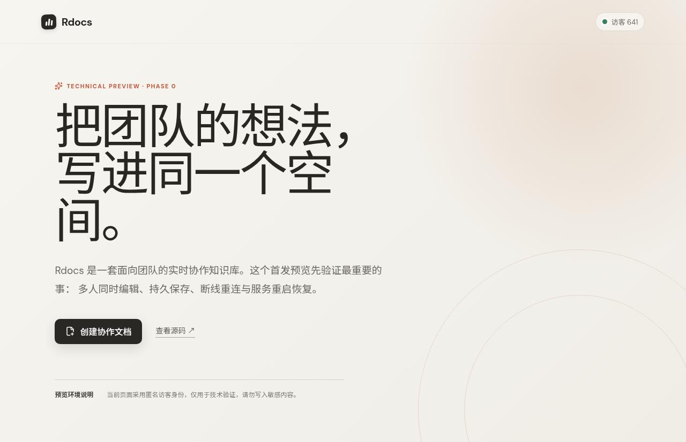

# Rdocs

Rdocs 是一个面向中小团队的多人实时协作知识库。项目以 React、Tiptap、Yjs、D1、R2 和 Durable Objects 为核心，目标部署平台是 **RandallFlare**，正式域名为 `docs.bigrandall.io`。

## 当前状态

当前仓库已经完成 v0.1 的协作文档主链路：

- React + Tiptap 富文本工作台与响应式首页。
- 多组织、成员邀请、用户组、空间和可恢复归档。
- 基于 D1 元数据的页面树、移动/排序、回收站和页面级独立 ACL（无权限、只读、读写、管理员）。
- Yjs / y-websocket 兼容协议。
- 浏览器 WebSocket 与应用层 HTTP/Yjs 双通道协作同步。
- 短期 HMAC 协作票据、同源校验和 256 KiB frame 上限。
- 每篇页面、每个 generation 一个 Durable Object。
- DO SQLite 增量持久化、重启恢复和阈值快照。
- 自动/手动版本、预览/比较、R2 不可变快照和幂等的新 generation 安全恢复。
- 统一使用 RandallFlare 账户登录：由 RandallFlare 网关完成登录与成员校验，Rdocs 不保存密码、设备密钥或自有会话。
- 精确 Origin 校验；被移出成员名单或退出登录后，下一次请求即失效并回到登录。
- D1 领域模型、恢复操作状态机和版本化迁移。
- 私有 R2 图片/附件、可过期的公开只读或可编辑分享链接，以及附件引用安全复制。
- Rdocs Sites：递归发布普通页面、独立路径与导航、浅色/暗色/系统主题、SEO/分享元数据、`robots.txt`/sitemap、站内搜索、匿名聚合分析与 Google Analytics；受限子树和数据库页面默认不公开。
- 标题/正文搜索、中文 token、最近访问、收藏、资料库批量管理、稳定块链接、评论、相对锚点和提及；页面通知三档偏好、权限感知去重投递、按页面/评论线程分组并可直接回复的收件箱，以及页面、正文 `@remind` 和数据库日期属性提醒。
- 跨页同步块的删除操作在每个引用位置保留同一恢复占位，30 天内可在严格双页权限校验下整体撤销且不覆盖后续编辑。
- generation 隔离的 IndexedDB 离线缓存、模板和 Markdown 导入导出。
- 权限版本检查和已打开连接的撤权关闭路径。
- RandallFlare 部署配置、单文件 Worker 构建和 CI。

应用已部署到 RandallFlare 的正式地址：

<https://docs.bigrandall.io>



`docs.bigrandall.io` 是唯一正式验收域名，旧自动域名已经停用。原生 WebSocket 已在平台修复后的正式域名通过双客户端同步、DO 持久化和重连恢复复验；HTTP/Yjs 恢复通道继续提供无感自动保存、在线状态和协作者光标气泡，详见 [RandallFlare 平台问题清单](docs/RANDALLFLARE_PLATFORM_ISSUES.md)。内部页面只对 RandallFlare 登录且在成员名单内的账户开放。

完整需求对照见 [Rdocs 实施状态](docs/ROADMAP_STATUS.md)，权限继承与四档矩阵见 [完整权限系统](docs/PERMISSION_SYSTEM.md)，与 Notion、飞书文档和飞书多维表格的边界见 [2026 产品对照](docs/PRODUCT_COMPARISON_2026.md)。

## 架构

```text
Browser
  ├─ HTTPS API ────────── Rdocs Worker ───── D1 / R2
  ├─ HTTP/Yjs fallback ── Rdocs Worker ───── DocumentRoom Durable Object
  └─ WebSocket ────────── Rdocs Worker ────────┘       └─ private SQLite
```

前端构建为单个内联 HTML，再与 API、WebSocket 路由和 DO class 一起打包为一个 ESM Worker，适配 RandallFlare 的 Git build `output file` 部署方式。

仓库结构：

```text
apps/web/          React + Tiptap 编辑器
apps/worker/       HTTP API、协作协议与 DocumentRoom
packages/shared/   前后端共享类型和约束
migrations/        D1 版本化迁移
tests/             线上纵向 smoke test
docs/              架构决策和平台兼容记录
```

## 本地开发

要求 Node.js 20 或更高版本。

```bash
npm install
npm run typecheck
npm test
npm run build
```

前端开发服务器：

```bash
npm run dev -w @rdocs/web
```

完整 Worker 本地运行依赖 RandallFlare 的 `rrangler dev` 与 `workerd`。生产配置位于 [`rrangler.json`](rrangler.json)。

## 部署到 RandallFlare

本项目只通过 `rrangler` 使用 RandallFlare 已有能力，不应修改 RandallFlare 平台代码。

生产发布只使用 RandallFlare 已有的 Git build。迁移前必须先导出并重放验证 Rdocs D1；业务代码合并到 `main` 后触发精确分支构建：

```bash
npm run build
npm run migrate:randallflare
node /develop/bigrandall.io/rrangler/bin/rrangler.mjs worker build rdocs --branch main
```

Rdocs 不创建、修改或补丁 RandallFlare 平台配置。下列绑定必须由现有 `rdocs` 项目配置提供；平台能力不足时记录到问题清单后停止对应能力上线。

配置会创建或同步以下 Rdocs 专属资源：

- Worker：`rdocs`
- D1：`rdocs-db`，binding `DB`
- R2：`rdocs-attachments`，binding `ATTACHMENTS`
- Durable Object：binding 与 class 均为 `DocumentRoom`

生产构建命令为 `npm ci && npm run build`，输出文件为 `dist/worker.js`。

登录完全交给 RandallFlare：`rdocs` 应用在平台上保持 **public** 访问模式，内部页面由 Rdocs 自己拦截，未登录访客被送到网关的 `/__rf_access/login`；分享链接、Sites 和公开表单仍可匿名访问。谁能进入由平台上 rdocs 应用访问页的**成员名单**决定，详见 [RandallFlare 登录](docs/RANDALLFLARE_SIGN_IN.md)。

## 验证

常规校验：

```bash
npm run format:check
npm run typecheck
npm test
npm run build
```

线上协作闭环：

```bash
RDOCS_SMOKE_ADMIN_SECRET='<secret>' \
RDOCS_SMOKE_URL='https://docs.bigrandall.io' \
RDOCS_SMOKE_ORIGIN='https://docs.bigrandall.io' \
npm run smoke:collab
```

该脚本验证 RandallFlare 原生 WebSocket 链路的双客户端收敛、DO 持久化、重连恢复和在线撤权。浏览器产品界面同时使用 HTTP/Yjs 恢复通道维持无感自动保存，并在 WebSocket 短暂不可用时继续收敛。

没有管理员密钥时，可以显式设置 `RDOCS_SMOKE_SKIP_REVOCATION=1`，仅跳过最后的在线撤权步骤；脚本会在结果中标明跳过项，不会把它误报为通过。

产品主链路 smoke 需要成员名单内测试账号的 RandallFlare 登录 Cookie；旧的匿名 smoke 不再适用于生产：

```bash
RDOCS_SMOKE_SESSION_COOKIE='<完整的 __Host-rf_user=... Cookie>' \
npm run smoke:product
```

它验证租户发现、页面创建/搜索/最近/收藏、页面权限、评论、私有附件、公开分享与撤销、Markdown、用户组、正式成员邀请、审计和回收站恢复。只应使用隔离的测试账号，运行后访问 `/__rf_access/logout` 使 Cookie 失效；当前还应改用两个已登记账号运行浏览器 E2E，不能为了测试重新开放匿名身份。

## 安全边界

生产业务 API 只接受 RandallFlare 网关注入的 `RF-User-*` 身份（网关会先剥离客户端伪造的同名请求头），且该账户必须在成员名单内。新邀请只允许管理员或正式成员；历史 `guest` 只作为外部只读兼容身份保留，不能加入用户组，空间和页面权限都由服务端永久封顶为只读。匿名用户只能通过仍有效的指定页面分享令牌或已发布 Site 打开内容；分享链接可选择只读或可编辑，Sites 仍为只读并会裁剪受限子树及隐藏祖先。完整边界见 [权限系统](docs/PERMISSION_SYSTEM.md)。
